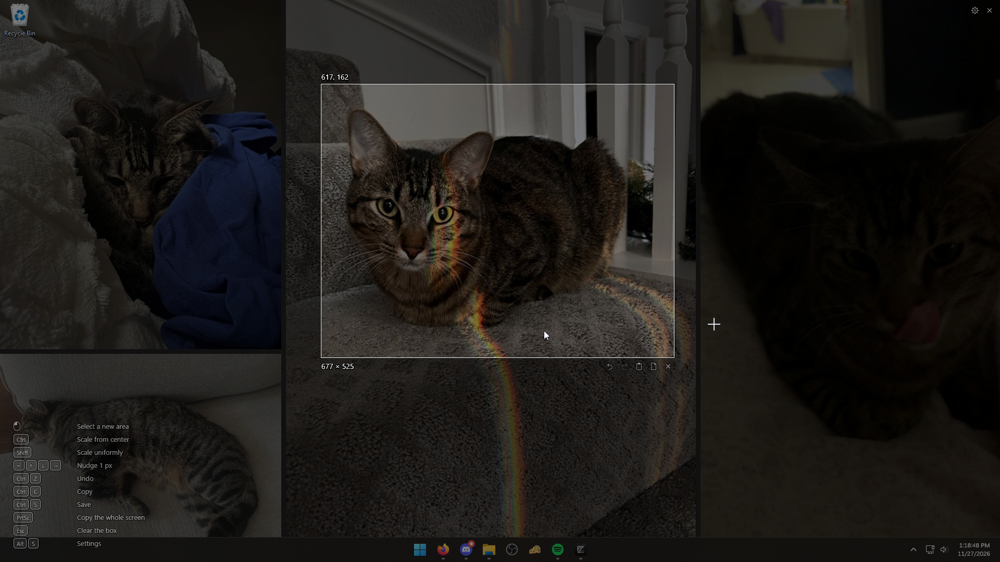

# snap
A lightweight screenshot tool for Windows coded in Rust.

Takes inspiration from [Lightshot](https://app.prntscr.com/en/index.html).

## Usage

Snap runs in the background and listens for the `PrtSc` key.

Press `PrtSc` to take a screenshot, opening the screenshot editor. Click and drag to draw a box around what you want to screenshot, then press `Ctrl+C` to copy the screenshot to the clipboard or `Ctrl+S` to save it to disk.

You can also copy or save the entire screenshot by pressing their respective keybinds without drawing a box. Additionally, you can press `PrtSc` a second time to quickly copy the entire screen.

Press `Ctrl+,` to open the settings menu where you can configure keybinds and app behavior.

## Installation

### Download from releases
1. Download `snap.exe` from the latest release on the [Releases](https://github.com/fallennseraph/snap/releases) page
2. Put it wherever you want and run it

## License

Snap is licensed under the MIT License. See the [LICENSE](LICENSE) file for details.
